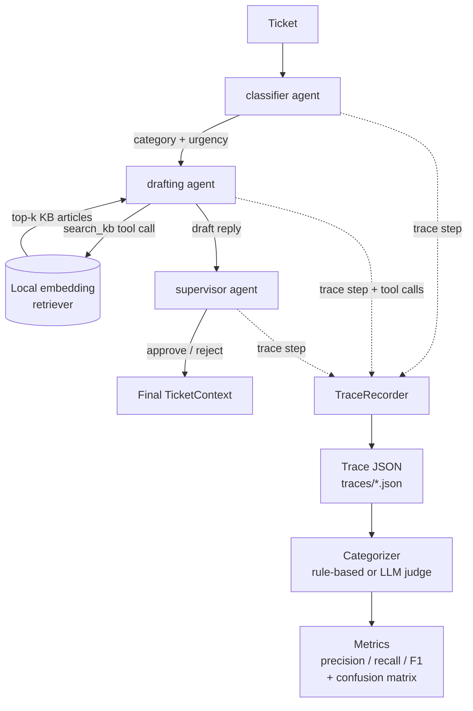

# agentlens

Runs a small multi-agent Claude pipeline (classify → search a knowledge base → draft
a reply → review it) and automatically categorizes *why* a run succeeded or failed:
bad retrieval, bad reasoning, a wrong tool call, or hallucination.

## Why this exists

I wanted a portfolio project that proves the same skill I used professionally —
tracing an AI system's full chain from retrieval to generated answer and pinpointing
where it broke down — as a reusable, from-scratch, open-source tool with no ties to
any employer's code or data. Everything here, including the synthetic tickets and
knowledge base, was written for this project specifically.

## How it works



Three agents run in a fixed sequence over one shared context object. Every agent
step, tool call, token count, and error gets captured into a `Trace` (Zod-validated,
one JSON file per ticket). A `Categorizer` then reads a trace and judges the outcome
into one of five buckets — either for free with deterministic rules, or by asking a
model to judge it. Both get measured the same way: precision/recall/F1 against a
hand-labeled golden set.

Full write-up: [`docs/architecture.md`](./docs/architecture.md) ·
[`docs/demo-scenario.md`](./docs/demo-scenario.md) ·
[`docs/evaluation-methodology.md`](./docs/evaluation-methodology.md)

## Status

- [x] Session 1 — orchestration engine, tracing, unit tests
- [x] Session 2 — real Claude-powered demo agents, local RAG retrieval, 26 synthetic
      tickets (built and unit-tested; the retriever is tested for free with a local
      embedding model — no API key needed for that)
- [x] Session 3 — rule-based failure categorizer, precision/recall/F1 metrics,
      golden-set evaluation CLI, optional LLM-judge categorizer for comparison
- [x] Session 4 — this README, architecture docs, CI, `--format json`, `--judge` flag
- [ ] **Pending**: an actual live `demo:run` against Claude, then manually labeling a
      real golden set and running `evaluate` to get real precision/recall numbers.
      Deferred until an `ANTHROPIC_API_KEY` is set up — see `docs/evaluation-methodology.md`
      for exactly what running it will produce.
- [ ] Session 5 (stretch, not started) — MCP server, minimal dashboard

## Quickstart

```bash
npm install
npm test                    # no API key needed — includes a real local-embedding test
npm run cli -- demo:fake    # toy 2-agent pipeline, scripted fake LLM, no API key needed
```

Running the real demo needs an Anthropic API key (pay-per-use, separate from a
Claude.ai/Claude Code subscription — get one at console.anthropic.com):

```bash
cp .env.example .env        # then fill in ANTHROPIC_API_KEY
npm run cli -- demo:run                              # ~26 tickets x 3 agents on claude-haiku-4-5, well under $1
npm run cli -- demo:report                           # raw per-ticket summary
npm run cli -- demo:report --format json             # same data as JSON

# after manually labeling tests/fixtures/goldenSet.json:
npm run cli -- evaluate --golden tests/fixtures/goldenSet.json
npm run cli -- evaluate --golden tests/fixtures/goldenSet.json --judge   # LLM-judge instead of rules, costs extra API calls
```

## Development

```bash
npm run lint        # eslint
npm run typecheck   # tsc --noEmit (checks src/ and tests/)
npm run build       # compiles src/ to dist/ (tests excluded)
npm test            # vitest
```

CI (`.github/workflows/ci.yml`) runs lint, typecheck, build, and the full test suite
on every push and PR — none of that touches the live Claude API, so it never costs
anything to run. A separate `live-demo` job exists but only runs when triggered
manually from the Actions tab, since it calls the real API.

## Known limitations

- `npm audit` currently reports some transitive advisories from `@xenova/transformers`'s
  dependency tree (`onnxruntime-web`, `protobufjs`, `sharp`) and from `vitest`'s dev
  toolchain (`vite`, `esbuild`). None are reachable here — nothing in this project
  parses untrusted protobuf data or exposes a dev server — but they're worth knowing
  about rather than silently ignoring.
- The rule-based categorizer's thresholds (`src/evaluation/rules.ts`) are starting
  guesses, not yet tuned against a real golden set (see the pending item above).

## License

MIT — see [LICENSE](./LICENSE).
