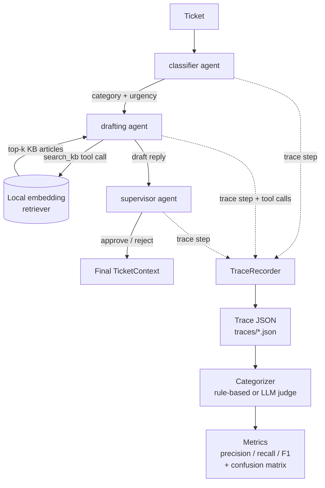

# Architecture

## Pipeline flow

Three agents run in a fixed sequence over one shared `TicketContext` ("blackboard")
object — each agent reads what it needs and returns only the fields it adds:

1. **classifier** — single structured-output call (`messages.parse` + a Zod schema).
   No tools. Assigns `category` and `urgency`.
2. **drafting** — the one agent that uses a tool. Runs the Anthropic SDK's beta Tool
   Runner with a `search_kb` tool backed by `LocalEmbeddingRetriever`. Drafts a reply
   grounded in whatever the retriever returns.
3. **supervisor** — another structured-output call. Reviews the draft against the
   ticket and retrieved docs, and approves or rejects it.

## Tracing

`TraceRecorder` wraps each agent invocation in `startStep`/`endStep`, capturing exact
input, the model used, token usage, stop reason, and any tool calls made while that
step was open (the drafting agent's `search_kb` tool records its own call via
`recorder.recordToolCall` from inside the tool's `run` function, including which docs
came back and their similarity scores). One `Trace` — a Zod-validated object — is
produced per ticket and written to `traces/<ticketId>-<runId>.json`.

This is deliberately *not* a generic multi-agent framework. `Agent<TContext>` is just
`(context) => Partial<context>`; `runPipeline` is a fixed, sequential loop, not a DAG
engine. That keeps the whole thing learnable end to end and fully unit-testable with
a scripted `FakeLlmClient` (see `tests/unit/pipeline.test.ts`) — a branching or
parallel orchestrator could be layered on top later without touching any agent code.

## Retrieval

`LocalEmbeddingRetriever` runs a small sentence-embedding model
(`Xenova/all-MiniLM-L6-v2`, via `@xenova/transformers`) entirely in-process: no
hosted vector DB, no second API key. Every KB article is embedded once at startup;
each query is embedded and ranked by cosine similarity against that index. It
implements a plain `Retriever` interface so a real vector DB could be swapped in
later without changing the agents that depend on it.

## Evaluation

`Categorizer` is deliberately a one-method interface (`categorize(trace) => {category,
rationale}`) with two implementations that can be compared on equal footing:

- **`RuleBasedCategorizer`** (`src/evaluation/rules.ts`) — free, deterministic,
  priority-ordered heuristics over a trace's shape (did it call the tool? was the top
  retrieval score high enough? does the draft state a specific claim not grounded in
  what was retrieved or the ticket? did the supervisor reject it anyway?).
- **`LLMJudgeCategorizer`** (`src/evaluation/llmJudge.ts`) — costs one API call per
  trace; asks a model to read the whole trace and judge the same five categories.

Both get scored the same way: `src/evaluation/metrics.ts` compares a categorizer's
predictions against a hand-labeled golden set and reports precision/recall/F1 per
category plus a confusion matrix. See `docs/evaluation-methodology.md` for the full
process and (once run) the measured numbers.
